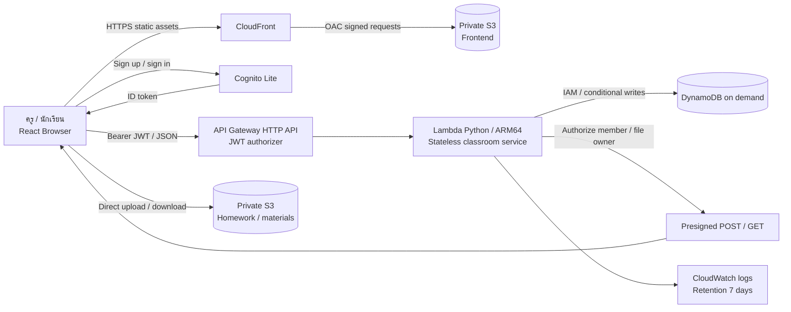

# Classflow - สถาปัตยกรรม AWS

## Architecture และ Data Flow

Browser ไม่ได้รับ AWS access key ฐานข้อมูลไม่มี public endpoint ที่ให้ผู้ใช้ query ได้โดยไม่มี AWS IAM authorization ไฟล์การบ้านไม่ผ่าน Lambda payload และไม่ใช้ S3 website public URL

การ deploy ใช้ CloudFormation ชุดเดียวที่บรรจุ backend และ frontend ที่บีบอัดไว้ มี Lambda สำหรับเผยแพร่เว็บแยกจาก API ทำงานเฉพาะตอน create/update สแตก สิทธิ์จำกัดให้เขียน bucket หน้าเว็บและ invalidate distribution ของสแตกนี้ ไม่มีสิทธิ์อ่านคะแนนหรือไฟล์การบ้าน ตัวเผยแพร่เติม config จาก Ref/GetAtt ของทรัพยากรจริง แล้วส่ง hashed assets ก่อน config/index; ไม่เรียกใช้งานทุกครั้งที่เปิดเว็บ

## What / Role / Why และทางเลือก

| บริการ | คืออะไร | หน้าที่ | เหตุผล / trade-off |
|---|---|---|---|
| Lambda | Compute เมื่อมีคำขอ | ตรวจสมาชิก, โพสต์, ส่งงาน, คะแนน, แชต | ไม่มี VM เปิดค้าง; มี cold start และ timeout |
| S3 | Object Storage | bucket หน้าเว็บ และ bucket ไฟล์ส่วนตัวแยกกัน | เหมาะกับ binary files; ไม่ใช้ filesystem ร่วมกัน |
| DynamoDB | Managed NoSQL | สมาชิก ห้องเรียน งาน คะแนน ข้อความ metadata | query ตาม partition และ conditional writes; ไม่สะดวก SQL joins |
| HTTP API | Managed API endpoint | รับ RPC และตรวจ JWT กับ Cognito | ใช้กับฟีเจอร์ CRUD ได้ตรงไปตรงมา; จำกัด rate ต่อ stage ไม่ใช่ hard spending cap |
| Cognito Lite | User directory / auth | Email confirmation, sign-in, admins/teachers groups | ไม่เก็บรหัสผ่านในโค้ด; Admin จัดการผู้ใช้ผ่าน API ที่ตรวจ group |
| CloudFront | CDN และ HTTPS | ส่งหน้าเว็บจาก S3 private ด้วย OAC | เพิ่มหนึ่งบริการเพื่อ TLS และ cache; deploy distribution ใช้เวลาและมี pricing ตามบัญชี |
| CloudWatch | Logs/metrics | วิเคราะห์ error และสาธิต observability | เก็บ log 7 วันเพื่อลดการสะสม; ยังต้อง monitor จริง |

ไม่สร้าง EC2, RDS, NAT Gateway, Load Balancer หรือ WebSocket API ส่วนกำหนดส่งและส่งช้าคำนวณจากเวลา UTC ใน backend จึงไม่ต้องมี EventBridge schedule ทุกนาที แชตใช้ HTTP endpoint เดิม

## Network boundary และ reliability

DynamoDB และ S3 เป็น managed regional services ไม่ได้วางอยู่ใน subnet ของ VPC ที่ผู้ใช้สร้าง Lambda ใช้ AWS service endpoints โดยไม่ผูก VPC จึงไม่ต้องเพิ่ม NAT Gateway เพื่อออกไป Cognito/S3 ไม่มีการเปิด database port ให้นักเรียนและไม่มี DB password ใน frontend

Public entry points คือ HTTPS CloudFront, Cognito sign-in และ API Gateway (ทุก API route ที่เข้าถึงข้อมูลใช้ JWT) S3 Block Public Access เปิดทั้งสอง bucket หน้าเว็บอ่านได้ผ่าน CloudFront service principal ที่จำกัด SourceArn เป็น distribution เดียวเท่านั้น

Lambda ไม่มี session/data authoritative ใน memory: ทุกข้อมูลอยู่ DynamoDB/S3 ขยาย concurrency ได้ตาม AWS quota S3/DynamoDB เป็นบริการที่จัดการความพร้อมใช้งานหลาย Availability Zones ให้ ไม่อ้างว่า deploy multi-region แล้ว เพราะระบบนี้ยังใช้ region เดียว

Default Lambda 256 MB ARM64 เป็นค่าเริ่มต้นสำหรับห้องเรียน ต้องวัด duration/cold start และปรับ memory จากผลจริง ห้ามอ้างว่าเพิ่ม memory แล้วเร็วหรือถูกกว่าเสมอ กำหนด throttling 10 requests/second, burst 20 ต่อ stage ไม่ตั้ง provisioned concurrency

## Data model

ใช้ตารางเดียว PK + SK และเก็บ data เป็น JSON string พร้อม version

| PK | SK | ข้อมูล |
|---|---|---|
| U#userId | PROFILE | ชื่อ รหัสนักเรียน; role มาจาก signed token เมื่อใช้งาน |
| U#userId | CLASS#classId | รายการห้องเรียนของผู้ใช้ |
| JOIN | joinCode | map รหัสเข้าห้องไป classId |
| C#classId | META | ชื่อวิชา เจ้าของ ห้องเรียน config เกรด |
| C#classId | MEMBER#userId | สมาชิกและบทบาทในห้อง |
| C#classId | STUDENT#studentId | จองรหัสนักเรียนไม่ให้ซ้ำด้วย conditional put |
| C#classId | POST#postId | งานหรือเนื้อหา พร้อมไฟล์และ Rubric |
| C#classId | EXAM#examId | ชื่อสอบและคะแนนเต็ม |
| C#classId | SUB#postId#userId | งานล่าสุด เวลา สถานะส่งช้า ครั้งที่ส่ง และ metadata ไฟล์ |
| C#classId | GRADE#assessmentId | คะแนนรายคน / Rubric / feedback และ version |
| C#classId | COMMENT#id | ความคิดเห็นโพสต์ |
| C#classId | DM#studentUserId#timestamp#id | สนทนาครู–นักเรียนของห้องเดียวกัน |
| C#classId | FILE#fileId | เจ้าของ, context, object key, ประเภท/ขนาดไฟล์ และสถานะ |
| C#classId | PUBLISHED | snapshot คะแนนรวมและเกรดที่เผยแพร่ล่าสุด |

ไม่มี Scan ทุกห้อง ใช้ Query ตาม PK/prefix พร้อม pagination ตัว class snapshot ไม่ query ข้อความแชตและตั๋วไฟล์ที่ไม่เกี่ยวข้อง แชตโหลดล่าสุด 100 ข้อความ แต่ query ประวัติใน partition ก่อนตัดรายการ จึงต้องเพิ่ม cursor/pagination เมื่อประวัติโตมาก

DynamoDB item จำกัดขนาด: จำกัดสมุดคะแนน JSON ที่ 350 KB ก่อนบันทึก Import สูงสุด 500 แถว ไฟล์ Excel ไม่เกิน 5 MB สมุดคะแนนที่มี feedback/rubric ยาวมากอาจถึงขนาดก่อน 500 คน ให้ลดความยาว feedback หรือแบ่งรายวิชาเป็นหลาย section ก่อนใช้งานขนาดใหญ่

## Authorization matrix

| คำขอ | ครูเจ้าของห้อง | นักเรียนสมาชิก | คนนอกห้อง |
|---|---|---|---|
| สร้าง/แก้งาน คะแนน เกณฑ์ เผยแพร่ผล | ได้ | ไม่ได้ | ไม่ได้ |
| อ่านเนื้อหาและคอมเมนต์ | ได้ | ได้ | ไม่ได้ |
| ส่งงาน | ไม่ใช้ flow นี้ | งานตนเอง | ไม่ได้ |
| อ่านงานและคะแนน | ทุกคนในห้อง | ของตนเอง | ไม่ได้ |
| แชตส่วนตัว | แต่ละ thread ในห้อง | thread ตนเอง | ไม่ได้ |
| ดาวน์โหลดไฟล์งาน | ทุกคนในห้อง | ของตนเอง | ไม่ได้ |
| ดาวน์โหลดไฟล์เนื้อหา | ได้ | ได้ | ไม่ได้ |

บทบาท Admin/ครูมาจาก Cognito groups และการเป็น owner ของห้อง ไม่เชื่อ role/userId จาก JSON ที่ browser ส่ง การจัดการผู้ใช้ทำได้เฉพาะ Admin ที่ผ่าน JWT authorizer และ Lambda มีสิทธิ์ Cognito เฉพาะ UserPool เดียว

ไฟล์จำกัด extension และขนาด Presigned POST อายุ 5 นาที กำหนด content-length-range และ Content-Type หลัง upload ตรวจ HeadObject ก่อนยืนยันไฟล์ Download link หมดอายุใน 60 วินาที ไฟล์ดาวน์โหลดเป็น attachment ไม่มีการประมวลผล macro และไม่มี antivirus scanning ใน scope นี้ ผู้ดาวน์โหลดต้องใช้เครื่องมือรักษาความปลอดภัยของตนเอง

## ความถูกต้องของคะแนน

Backend ตรวจคะแนน finite, ช่วง 0–คะแนนเต็ม, roster membership, rubric sum และ expected version Import ตรวจทุกแถวก่อน conditional put สมุดคะแนนครั้งเดียว ไม่เผยแพร่ข้อมูลบางส่วนเมื่อพบข้อผิดพลาด

Grade Lab เป็น simulation: คำขอ preview ไม่แก้ config ที่ใช้จริง การบันทึกเกณฑ์และการเผยแพร่ผลเป็นคนละการกระทำ ผลเผยแพร่เป็น snapshot ไม่เปลี่ยนตามการทดลองเกณฑ์

## ค่าใช้จ่ายและการควบคุม

- ใช้ pay per use: Lambda และ DynamoDB on demand; S3 ตามพื้นที่และ request
- โหลด ExcelJS เมื่อใช้ import/export เท่านั้น ประมวลผล Excel และสร้างรายงานใน browser
- cache hashed assets 1 ปี; index.html/config.js no-cache และ invalidation เฉพาะสองไฟล์
- แชต poll ทุก 15 วินาทีเฉพาะหน้าสนทนาที่มองเห็น ไม่สร้าง scheduled backend jobs
- จำกัดไฟล์ 25 MB และ log retention 7 วัน แต่ไฟล์ที่เก็บไว้ยังมีต้นทุนจนลบจริง
- ตรวจเครดิตและ Free/Paid plan ปัจจุบันก่อน deploy ตัวเลขเครดิตในอดีตไม่ใช่ยอดปัจจุบัน ไม่สมัคร flat-rate CloudFront plan หรืออัปเกรดบัญชีอัตโนมัติ
- แนะนำ Budget actual/forecast alert ที่ $1/$5 หลังตรวจสิทธิ์และ email ของบัญชี แต่ alert ไม่ใช่ hard cap และข้อมูลอาจล่าช้า
- หลัง demo ลบข้อมูลทดสอบ/stack ตามขั้นตอนพร้อมตรวจ S3/CloudWatch resources ที่อาจคงอยู่

## แหล่งอ้างอิง AWS

- [API Gateway JWT authorizer](https://docs.aws.amazon.com/apigateway/latest/developerguide/http-api-jwt-authorizer.html)
- [CloudFront OAC กับ S3 private origin](https://docs.aws.amazon.com/AmazonCloudFront/latest/DeveloperGuide/private-content-restricting-access-to-s3.html)
- [Presigned POST policy](https://docs.aws.amazon.com/boto3/latest/reference/services/s3/client/generate_presigned_post.html)
- [AWS Free Tier และเครดิต](https://docs.aws.amazon.com/awsaccountbilling/latest/aboutv2/free-tier.html)
- [AWS Budgets และข้อจำกัดการแจ้งเตือน](https://docs.aws.amazon.com/cost-management/latest/userguide/budgets-managing-costs.html)
